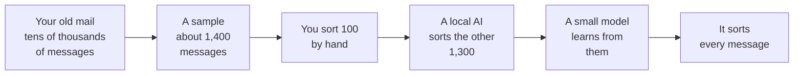

# Ellf Template: Mail Triage

An [Ellf](https://ellf.ai) template that sorts the messages in a mail archive
into categories you define. It trains a small spaCy text classifier on labels
that a local LLM gives, and it runs on your own machine, so no mail has to
leave it. The default categories sort by what to keep: work, personal, admin
(your own records), automated and bulk.

The question it answers: on your own archive and your own categories, how
close does a small model that runs locally get to an LLM, and what does each
cost in machine time and in the hours a person spends labelling? It scores the
model against the local LLM it learnt from, run through Ollama so no mail
leaves your machine; against a person, on the 100 messages they labelled to
settle the categories; and, for the default categories, against Gmail's own.

## How it works

Think of it as training an assistant to sort your post. You sort a hundred
letters yourself to agree what each pile means and to check a capable but
slow helper (the LLM), which then sorts a thousand more. A small, fast
assistant learns from those and sorts the whole archive. Everything happens
on your own computer.

Where the AI disagrees with your 100, the kinds or its instructions are
changed before it sorts the rest. The AI doesn't learn from your 100.

### The five kinds

The default kinds answer one question: what to keep. A kind is advice, not a
decision: whatever acts on it still has to respect legal holds and duties to
keep records.

| Kind | What it is | |
|---|---|---|
| WORK | mail about your job | keep |
| PERSONAL | people you know, writing about your life | keep |
| ADMIN | your own records: receipts, contracts, tax | keep |
| AUTOMATED | codes, alerts, shipping updates | can go |
| BULK | newsletters, marketing, mailing lists | can go |

The costly mistake is mail worth keeping put in a kind that can go, so the
model is judged above all on how rarely it makes that one.

### What it costs

Measured on one archive and one Mac (an M2 with 24 GB):

| | Your time | Computer time |
|---|---|---|
| Sorting 1,000 messages by hand | about 90 minutes | none |
| Settling the kinds: 100 messages and a review, per round | about 15 minutes | about 7 minutes |
| The local AI (Qwen3 14B) sorting 1,000 messages | none | about an hour |
| The small model sorting 1,000 messages | none | to be measured |

No mail leaves your computer in any of these.

The technical side, with diagrams of the parts and the data flow, is in
[docs/architecture.md](docs/architecture.md), and the results so far in
[docs/results.md](docs/results.md).

## Languages

An archive is often in more than one language, and the kinds of mail may
differ between them, so results are given per language as well as per age of
mail. The importer records a rough guess at each message's language.

## Status

`scripts/mail_to_jsonl.py` turns an mbox, a folder of `.eml` files or a Got
Your Back backup into JSONL for Ellf, `scripts/make_splits.py` draws the
pilot, eval set and training pool from it, `scripts/score.py` scores labels
against each other, and `assets/` holds the default categories.
[docs/design.md](docs/design.md) says how the rest will work and
[docs/backlog.md](docs/backlog.md) what comes next.

## Privacy

The template ships synthetic sample mail with fictional senders. Nothing from
real mail is published: no messages, no quotes, and no model trained on real
mail. The write-up reports figures only.

## Licence

[MIT](LICENSE).
