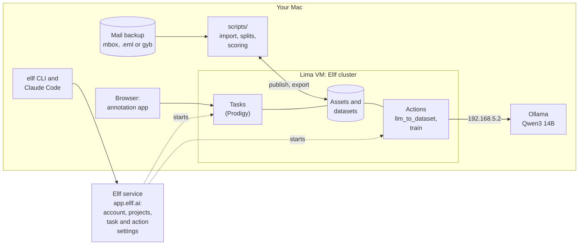
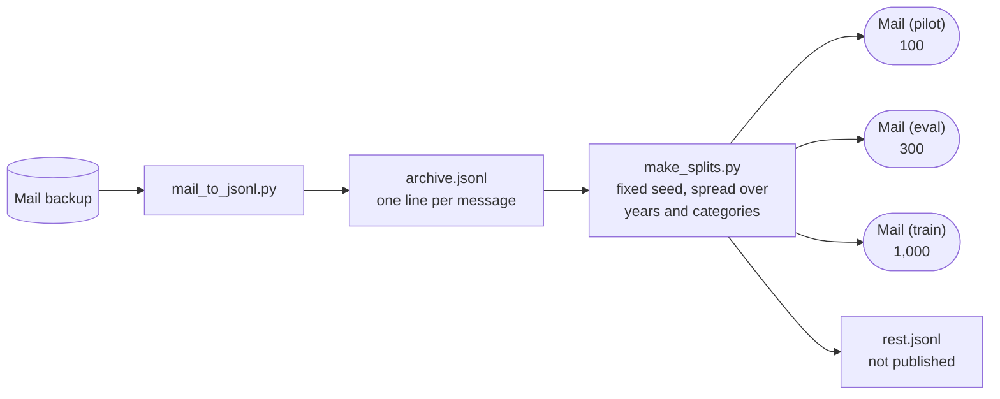
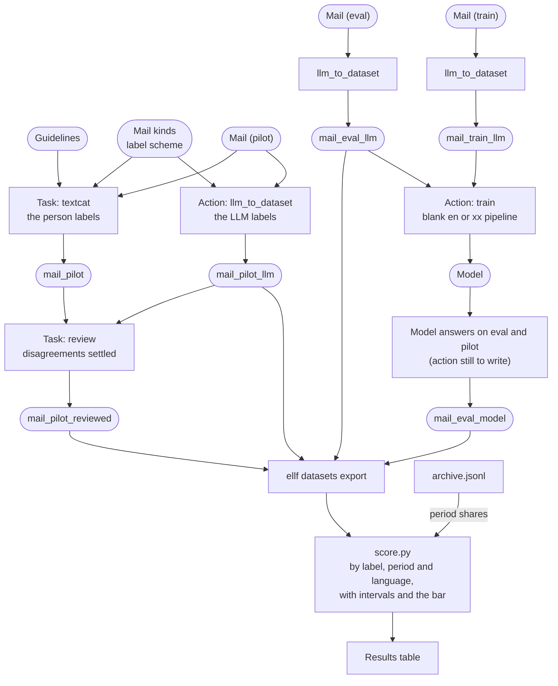
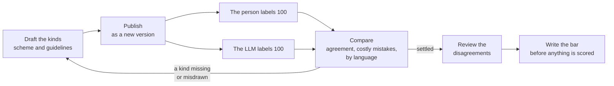
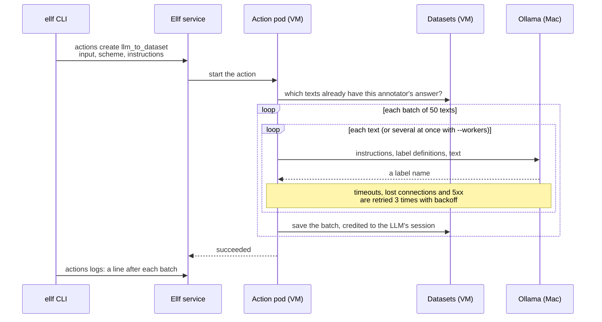
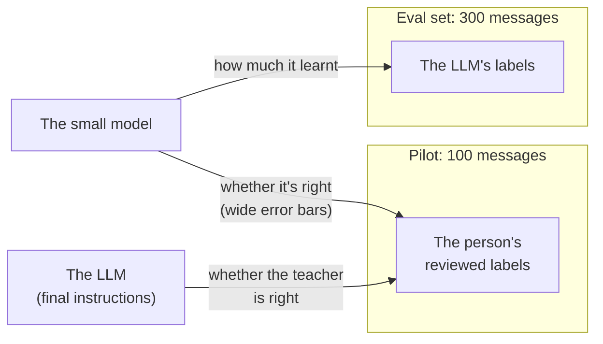
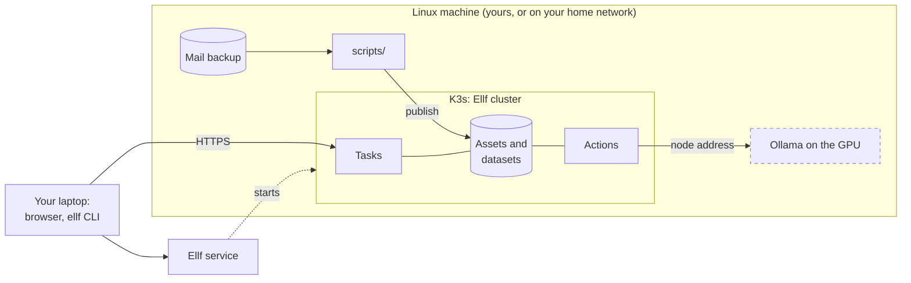
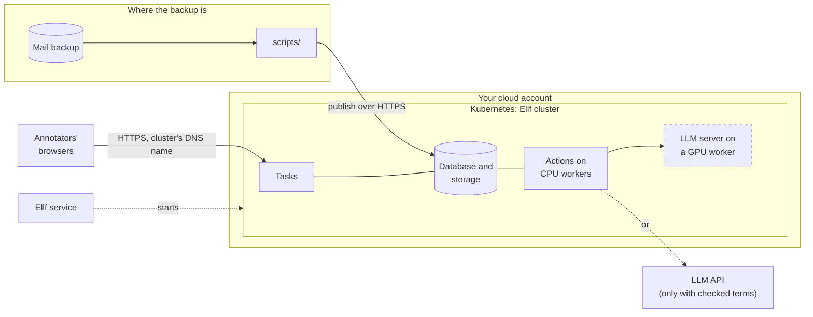
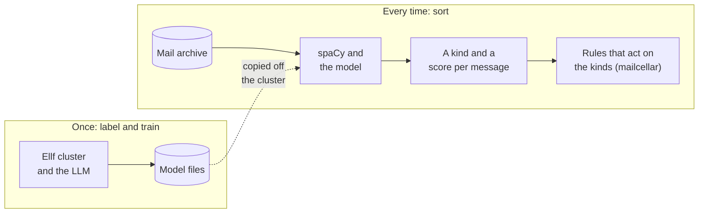

# Architecture

How the template's parts fit together, as set up for the write-up: one
Mac, with Ellf's cluster in a Lima VM and the LLM in Ollama. Why each part
was chosen is in [design.md](design.md); the facts behind it, with sources,
are in [facts.md](facts.md). Other set-ups are at the end.

## Where things run

Mail is read on the Mac, labelled on the cluster in the VM, and sent to
the LLM over the VM's link to the Mac, so it doesn't leave the machine.
Ellf's own service holds the account, the projects, and the settings of
each task and action, which include the LLM's instructions. That is why
the instructions are kept generic.

## Data flow

### Preparing the data

`mail_to_jsonl.py` writes one line per message. The text is the sender,
the subject, whether there's a `List-Unsubscribe` header, and the first
1,000 characters of the body. The meta holds a hash of the Message-ID,
the date, the sender's domain, Gmail's category, whether you sent it, and
a guess at the language. Files stay outside the repository; the rounded
boxes are Ellf assets.

### Labelling and scoring

Dataset names are examples; any will do.

## Settling the scheme in the pilot

The pilot ran three times before the scheme held (see
[results.md](results.md)). A count-only profile of the archive, drafted
before anyone labels, would likely have saved a round.

## One LLM run

What happens when `llm_to_dataset` labels an asset. From version 0.2.0 of
`mail_recipes` it saves every 50 answers and skips texts already answered,
so a stopped run can be started again.

## What is compared with what

The person labelled only the pilot. So the small model is scored twice:
against the LLM it learnt from, on the eval set, which says how much it
learnt; and against the person, on the pilot, which says whether what it
learnt is right, with wide error bars.

## Other set-ups

The set-up above is the write-up's: one Mac, the free Solo plan. Elsewhere
two things change: where the cluster runs, and how it reaches the LLM. The
scripts run wherever the mail backup is, on any system with Python. Which
plan allows which cluster, and what Ellf's servers keep, is in
[facts.md](facts.md#ellf-plans-and-the-service). Dashed boxes are
**unverified**.

### A Linux machine

On Linux, K3s runs on the machine itself, so the VM and its network
workarounds go. Ollama runs on the same machine, ideally with a GPU. The
action is pointed at it with `--base-url`, at the node's address rather
than `192.168.5.2` (**unverified**: not tried). Labelling from another
machine on the network goes over HTTPS, with the certificate
`ellf infra tls` issues.

### A cloud account

On a team plan the cluster runs in your own cloud account, with workers
in classes (`base`, `small`, `medium` and `gpu`), a managed database and
an ingress with its own DNS name. Two things then matter for privacy:

- **The mail leaves your machine** for your cloud account, where the
  splits are published. "No mail leaves your machine" becomes "no mail
  leaves your account", and the provider's terms on stored data apply.
- **Where the LLM runs.** A model served inside the account, on a GPU
  worker or a GPU VM next to the cluster, keeps the mail there, but you
  have to run that server yourself: Ellf has no built-in agent that runs
  an LLM on the cluster, and how to run one as an Ellf service is
  **unverified**. An LLM API sends the mail to its provider, which this
  project allows only once the provider's data-use terms are checked.

### Using the trained model

Ellf, the cluster and the LLM are needed only to label and train. Sorting
an archive with the trained model needs only spaCy and the model's files,
wherever the archive is: no cluster, no LLM, no network. That is the part
a tool such as mailcellar runs, and why the small model is worth
training. How the model's files leave the cluster is **unverified**.

